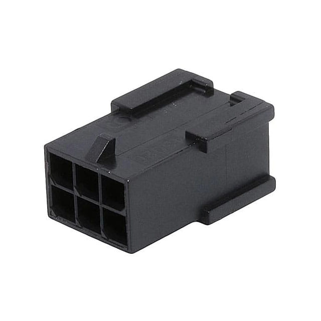
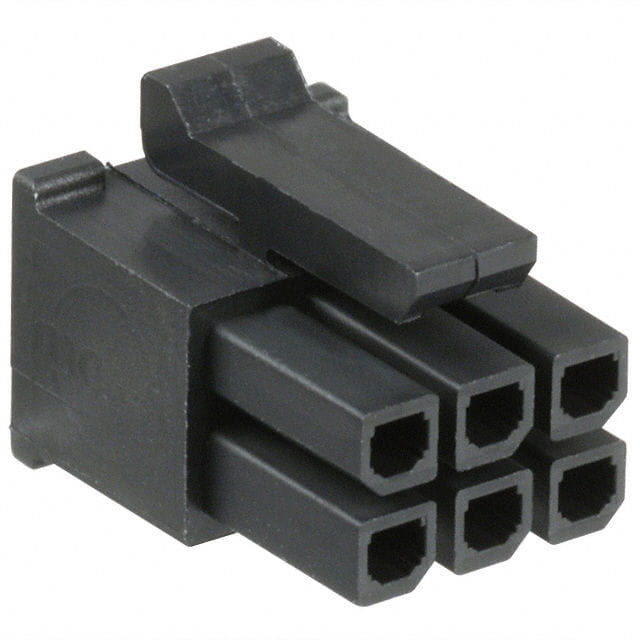
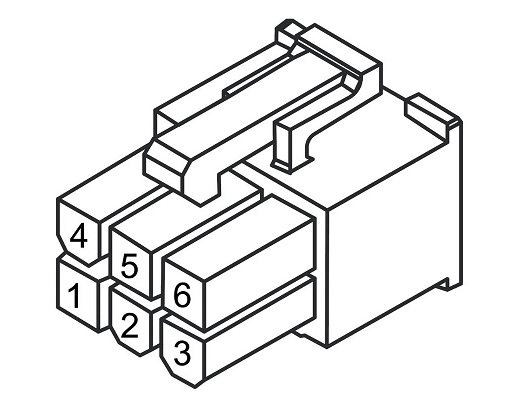
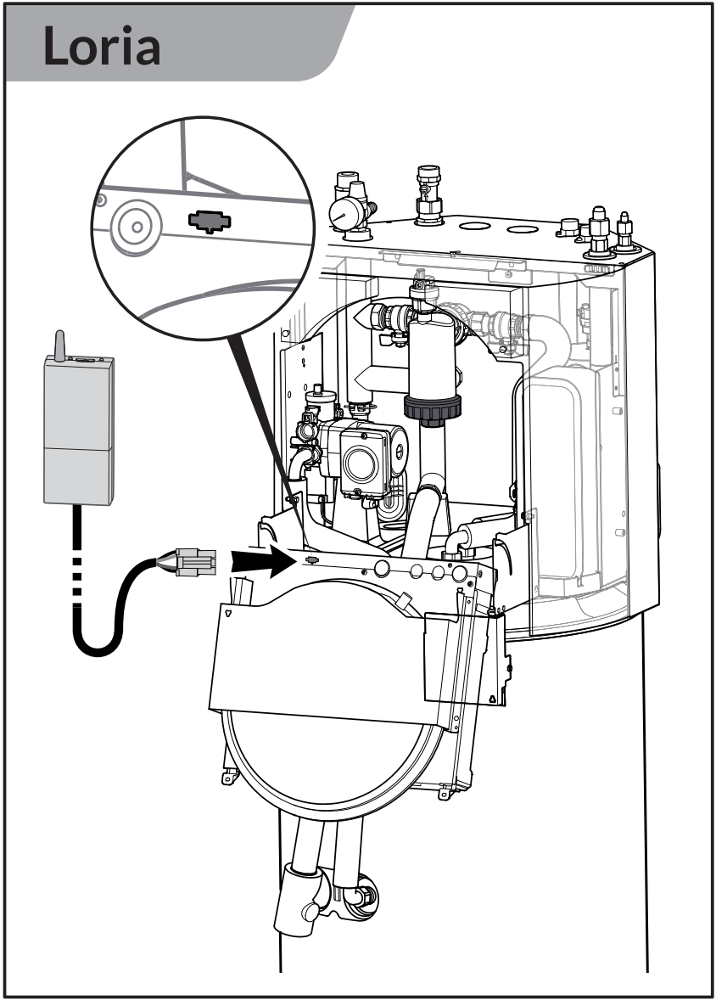
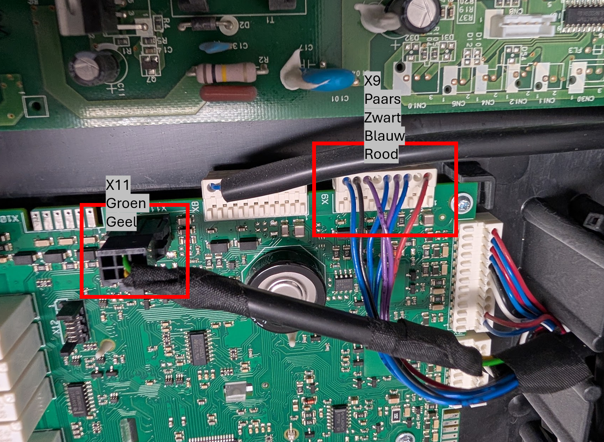
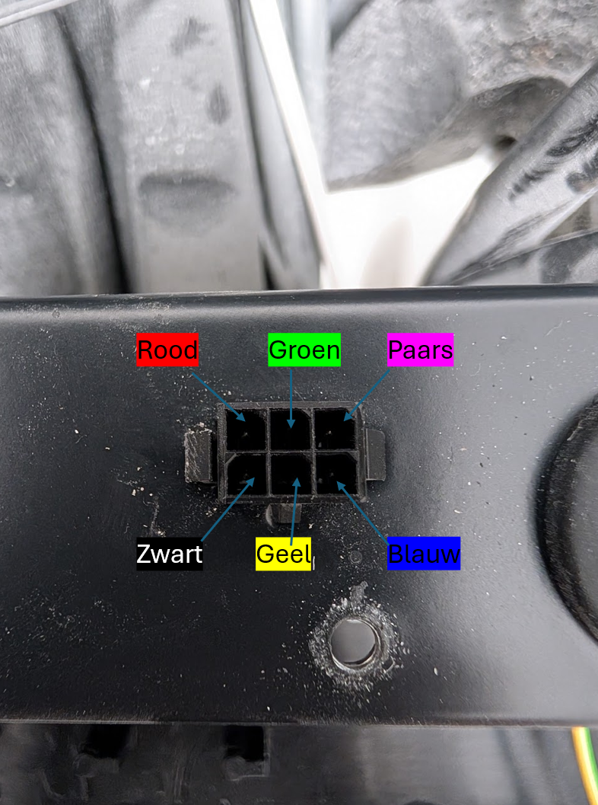

# Mapping of the Atlantic Loria Modbus interface

This project describes all known Modbus functions and registers for the Atlantic Loria Heat Pump. The goal is to map all registers so these can be used to log sensor data like Temperature, Flow and Frequency.

It also describes how to make a connection to the Modbus interface. Including wiring and connection settings.

## Protocol
The Atlantic Loria Heat Pump uses the Modbus RTU protocol through a rs485 serial interface. All public functions 0x1, 0x2, 0x3 and 0x4 return empty responses. Only proprietary function x41 and x42 are implemented. (Keep in mind most Modbus tools don't support functions other than 0x1 through 0x4)

Registers are divided into two files. A file with mapped registers and a file with unmapped registers. Please update accordingly.
- mapped.txt
- unmapped.txt

## Wiring

The Male Molex 3x2 connector is located underneath the expansion vessel. (See image above)

---

You'll need a Female Molex 3x2 connector. (See image above)

---

- 1: 24v DC
- 2: 
- 3: A (Data)
- 4: GND
- 5: 
- 6: B (Data)

## Connector location

## Connection settings
- Baudrate: 19.200
- Data Bits: 8
- Parity: None
- Stop Bits: 1
